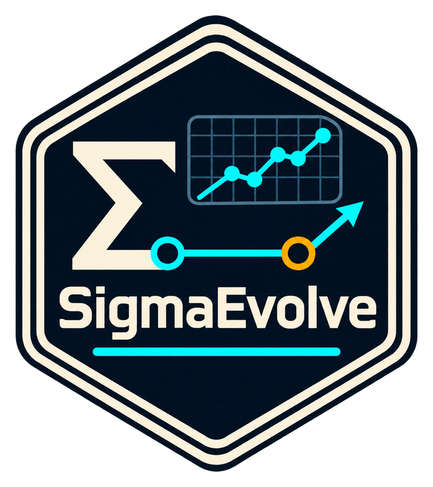

<p align="center">
  
  <br />
  <!-- repo-tagline:start -->
  <strong>🧬 Evolutionary training runs for immutable datasets 🧬</strong>
  <!-- repo-tagline:end -->
</p>

SigmaEvolve evolves classification training scripts while keeping the dataset
fixed. It ranks candidates by validation accuracy and records their source,
prompt provenance, and results in Postgres.

## Quickstart

With Python 3.11+, uv, and a configured Postgres database, follow the
[setup guide](docs/sigmaevolve-guide.md#install). Seed the bundled MNIST track:

```bash
uv run sigmaevolve create-track sigmaevolve/baselines/mnist.py
```

The command creates the track and baseline trial. The guide covers candidate
generation, local and Modal execution, and the Next.js dashboard.

[SigmaEvolve experiment setup and execution](docs/sigmaevolve-guide.md).

## License

[MIT License](LICENSE).
